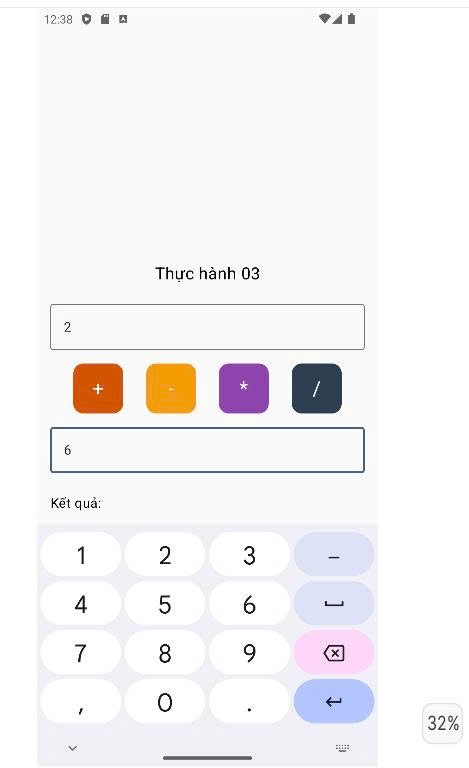
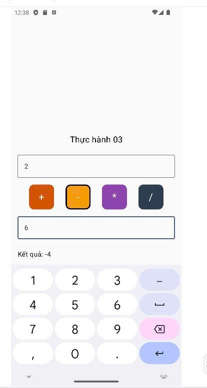
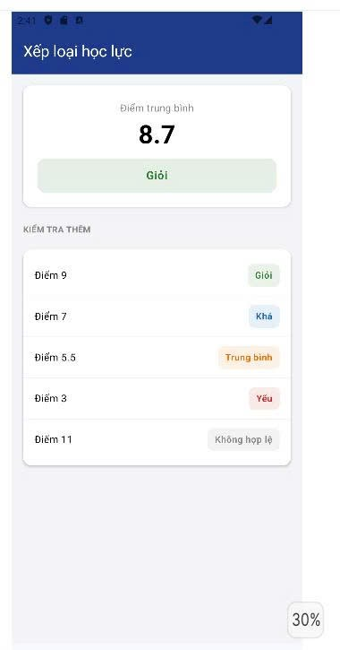
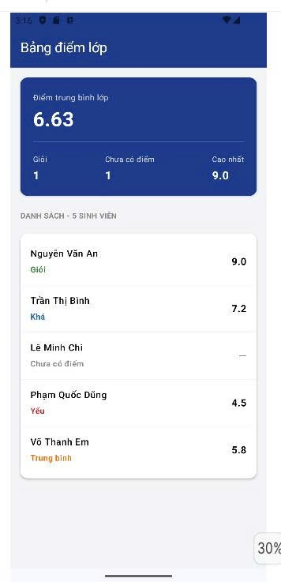

BÀI TẬP 2 - Tuần 2

1. Thông tin sinh viên

- Họ và tên: Bùi Ngọc Trang

- MSSV: 079306029517

- Môn học: Lập trình thiết bị di động di động

2. Mục tiêu bài tập

    **Bài 1** 

- Nhập 2 số, chọn phép toán (+, -, *, /) và hiển thị kết quả

- Xử lý nhập liệu từ TextField và quản lý trạng thái (`state`)

- Output

                                 

    **Bài 2**

- Tạo class `Student` (`name`, `email?`, `phone?`) và danh sách 5 sinh viên có dữ liệu `null`

- Dùng vòng lặp `for` duyệt danh sách, dùng toán tử `??` hiện chữ *"Chưa cập nhật"* màu đỏ và đếm số sinh viên thiếu email

- Output

    **Bài 3**

- Viết hàm xếp loại điểm số dựa vào cấu trúc `if/else`

- Đổi màu chữ linh hoạt theo từng mức xếp loại và kiểm tra thêm các mốc điểm 

- Output

    **Bài 4**

- Hiển thị bảng điểm lớp với sinh viên có điểm dạng `Double?`

- Dùng `for` và `if` để tính điểm trung bình lớp (bỏ qua người chưa có điểm), đếm số sinh viên Giỏi, số người chưa có điểm và tìm điểm cao nhất

- Output

