BÀI TẬP 3 - Tuần 3

1. Thông tin sinh viên

- Họ và tên: Bùi Ngọc Trang

- MSSV: 079306029517

- Môn học: Lập trình thiết bị di động di động

2. Mục tiêu bài tập

   **MÀN HÌNH GIỚI THIỆU**

- Xây dựng giao diện bằng Jetpack Compose

- Hiển thị logo, tên và nội dung giới thiệu về Jetpack Compose

- Nhấn nút I'm ready để chuyển sang danh sách các thành phần giao diện

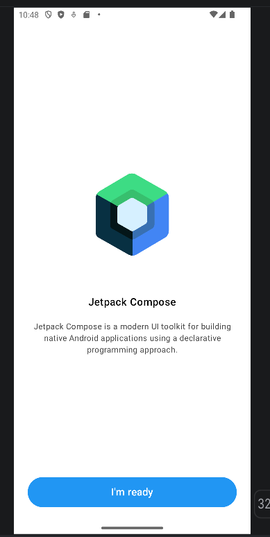

    **DANH SÁCH CÁC THÀNH PHẦN GIAO DIỆN**

- Hiển thị các thành phần theo nhóm chức năng

- Cho phép cuộn danh sách và mở màn hình minh họa của các thành phần đã triển khai

- Sử dụng nút ‹ hoặc nút quay lại của thiết bị để trở về danh sách; từ danh sách quay về màn hình giới thiệu

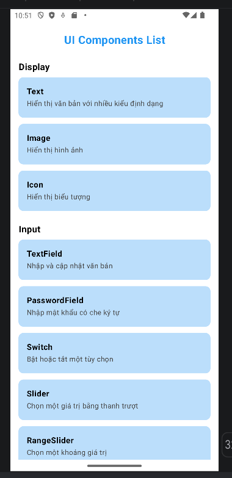             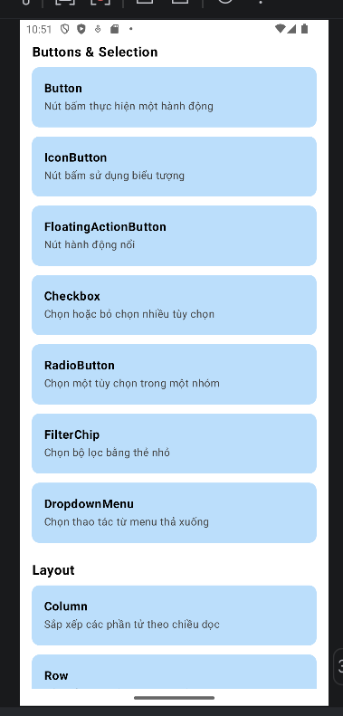

    **DISPLAY**

- Text: Hiển thị văn bản với nhiều định dạng: màu sắc, kích thước, in đậm, in nghiêng, gạch chân, gạch ngang và giãn cách ký tự

- Image: Hiển thị ảnh từ Internet bằng Coil và ảnh uth.jpg được lưu trong tài nguyên của ứng dụng

- Icon: Hiển thị biểu tượng với màu sắc và kích thước khác nhau

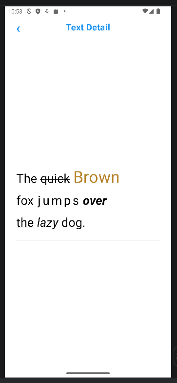       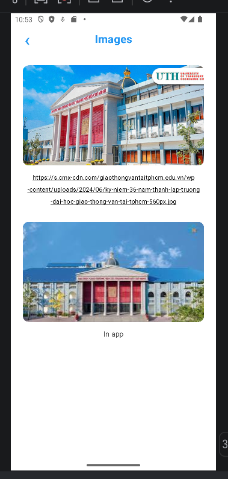       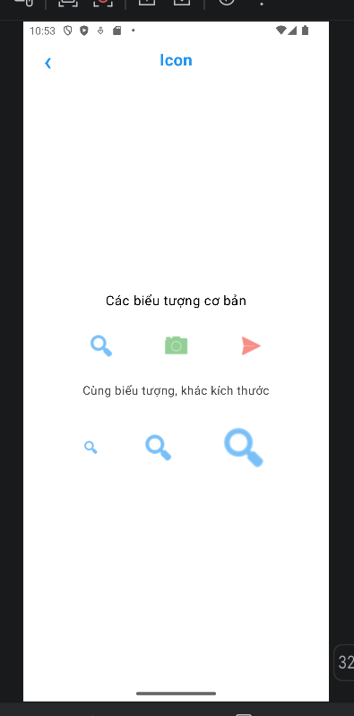

    **INPUT**

- TextField: Nhập văn bản và cập nhật nội dung hiển thị theo dữ liệu nhập

- PasswordField: Nhập mật khẩu, che ký tự và cho phép chuyển đổi giữa hiện hoặc ẩn mật khẩu

- Switch: Bật hoặc tắt tùy chọn và cập nhật dòng thông báo trạng thái

- Slider: Chọn một giá trị bằng thanh trượt và hiển thị giá trị hiện tại

- RangeSlider: Chọn khoảng giá trị gồm giới hạn dưới và giới hạn trên

- DatePicker: Mở hộp thoại chọn ngày và hiển thị ngày sau khi xác nhận

- TimePicker: Chọn giờ, phút và hiển thị thời gian đã chọn

- Quản lý trạng thái tương tác bằng rememberSaveable và mutableStateOf

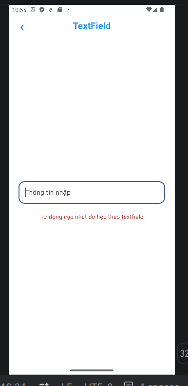       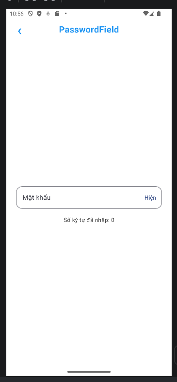       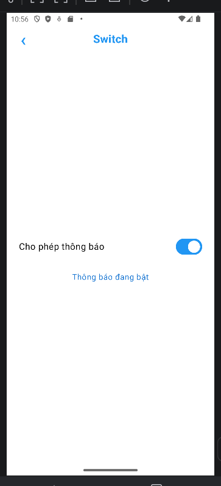

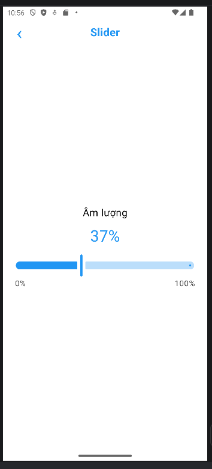       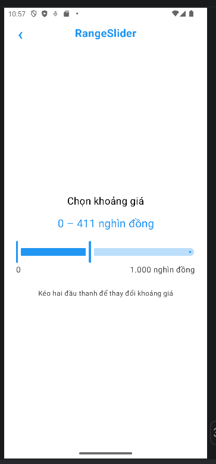       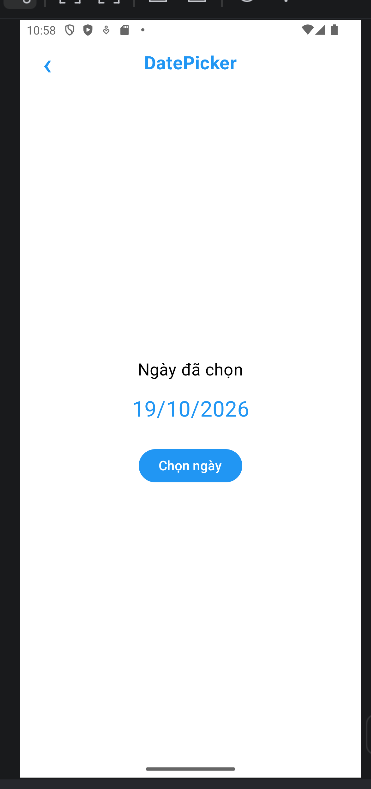

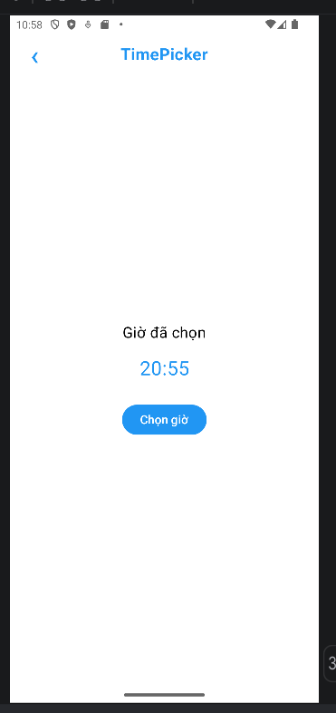

    **BUTTONS & SELECTION**

- Button: Minh họa nút tăng, giảm, đặt lại bộ đếm và trạng thái nút bị vô hiệu hóa

- IconButton: Sử dụng nút biểu tượng ngôi sao để thêm hoặc bỏ yêu thích, đồng thời cập nhật màu và nội dung trạng thái

- FloatingActionButton: Hiển thị nút hành động nổi ở góc dưới bên phải; bấm nút + để tăng bộ đếm

- Checkbox: Cho phép chọn nhiều nội dung học cùng lúc và hiển thị danh sách các nội dung đã chọn

- RadioButton: Cho phép chọn một trình độ học trong nhóm và cập nhật kết quả theo lựa chọn

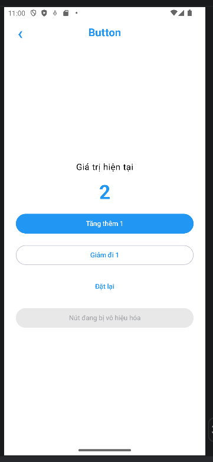        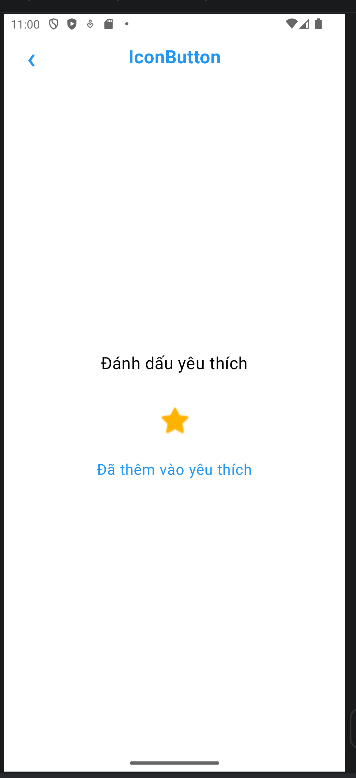        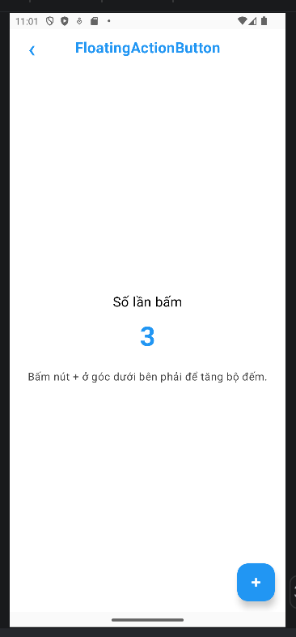

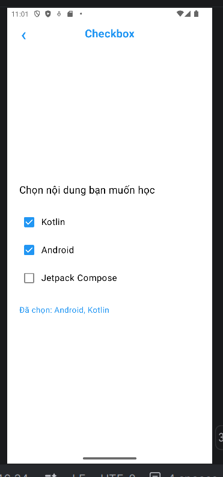        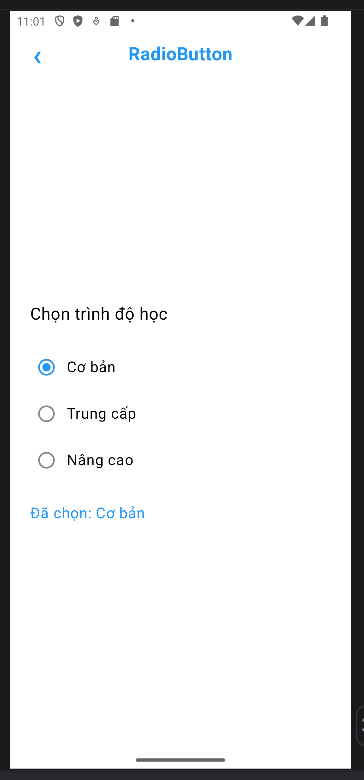